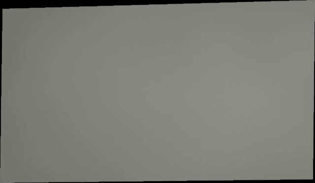
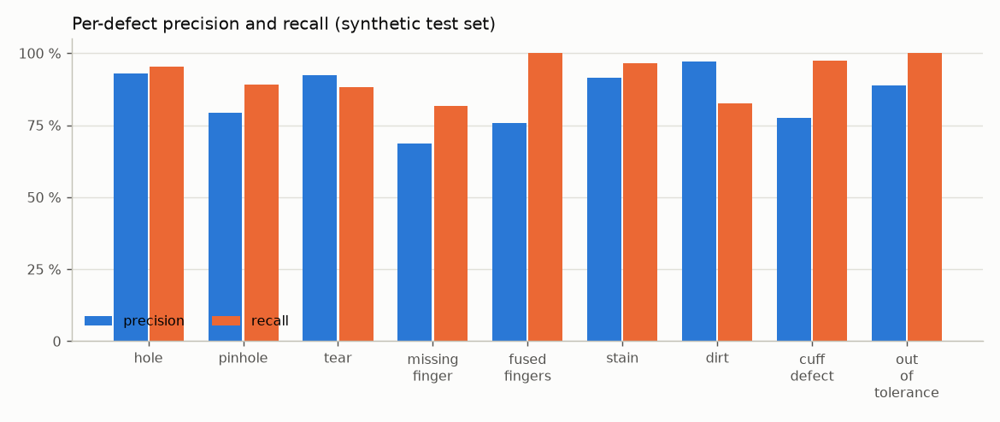
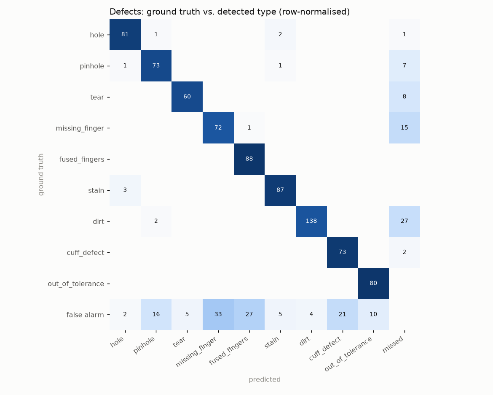
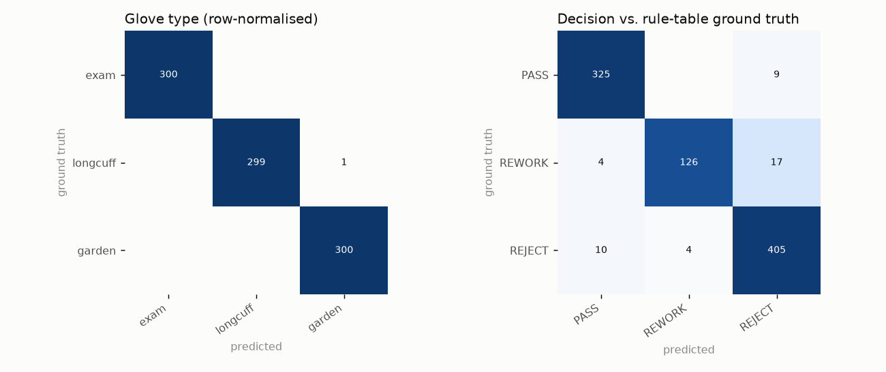
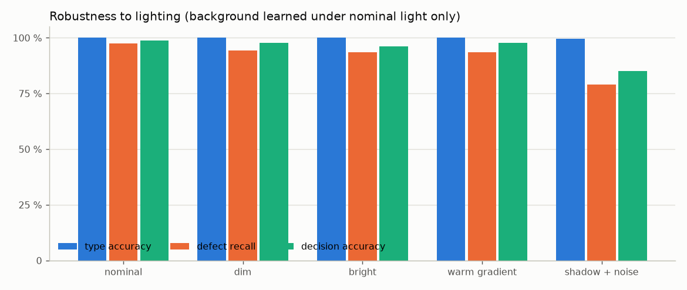
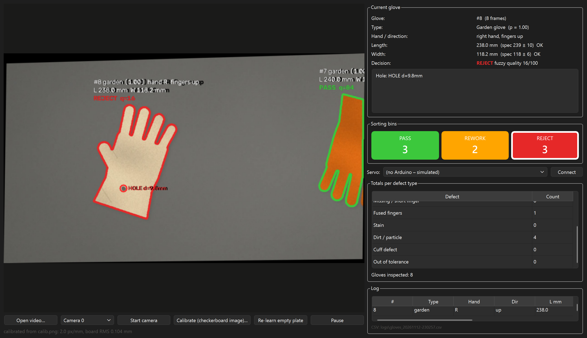
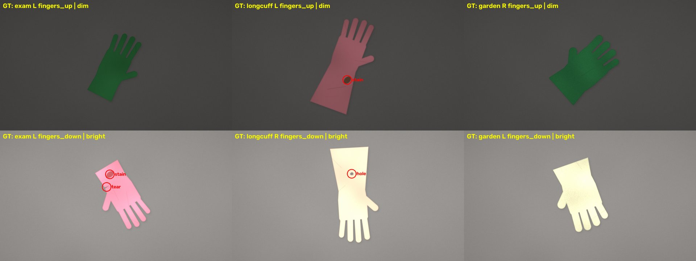
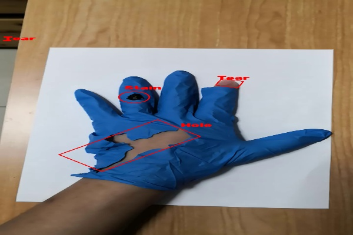
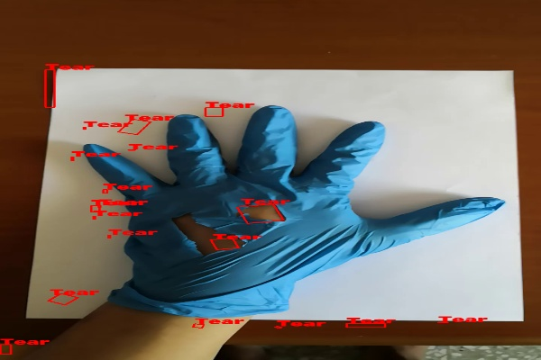

# Vision-Based Glove Defect Inspection & Sorting

A camera-based inspection station for disposable and work gloves. It identifies the glove type by **size and shape**, measures length and width in **millimetres** against a tolerance, finds **nine defect types** with their size in mm, records **left/right hand and finger direction**, decides **PASS / REWORK / REJECT** with **fuzzy logic**, and sorts each glove into a bin: in the GUI, and optionally with an **Arduino servo**. Built with OpenCV, scikit-learn, scikit-fuzzy and PySide6.

**Author:** Muhammad Ali Sadiq
<br>*Originally developed in 2020 as a university group project. Redone from scratch by me alone in 2026, reusing ideas from my surviving 2020 code. See [2020 original vs. 2026 redo](#2020-original-vs-2026-redo).*



> **Important:** all quantitative results below come from a **synthetic** test set (procedurally rendered gloves with exact ground truth, see [Data](#data)). The system has **not yet been tested on real gloves**. That is the next step, see [Status](#status).

## Documentation

| | |
|---|---|
| [User guide](docs/user-guide.md) | install, camera station set-up, calibration, GUI, Arduino wiring, CSV fields, troubleshooting |
| [Technical reference](docs/technical.md) | every algorithm with equations, fuzzy rule base, generator, full configuration reference |
| [Evaluation](docs/evaluation.md) | test method, metric definitions, targets vs. results, error analysis |
| [Design proposal](docs/DESIGN.md) | the plan and test targets written before building |

## Motivation

Glove factories inspect millions of gloves a day; holes, tears, stains and malformed fingers have to be caught before packing. In 2020 our university team built a first version. It only worked on the one video its colour thresholds were tuned on. In 2026 I rebuilt it as a proper, measurable system: lighting-robust, colour-agnostic, calibrated in millimetres, and evaluated against ground truth.

## My role

Everything in this repository is my own 2026 work: the synthetic data generator, the inspection pipeline, the classifier and fuzzy decision, the GUI, the Arduino sketch, the tests and the evaluation. In the 2020 group version my part was the defect detection (hole, stain, exposed fingertip) and a simple Tkinter GUI; those files are kept unchanged in [`legacy-2020/`](legacy-2020/). No teammate code from 2020 is used.

## Tech stack

| | |
|---|---|
| Language | Python 3.12 |
| Vision | OpenCV 5 (checkerboard homography, LAB colour space, morphology, contours, convexity, Hu moments) |
| Learning / decision | scikit-learn MLP (glove type), scikit-fuzzy Mamdani system (PASS / REWORK / REJECT) |
| GUI | PySide6 (Qt) |
| Hardware (optional) | Arduino Uno/Nano + one hobby servo as a 3-position diverter, USB serial (pyserial) |
| Testing | pytest (28 tests), evaluation scripts with confusion matrices |
| Not used (by design) | Haar cascades, TensorFlow / deep learning, template or pattern matching |

## How it works

```
camera frame
  │  checkerboard calibration (once)  → homography → top-down image, 2 px/mm
  ▼
illumination normalisation  ─ per-channel gain field a + b·x + c·y fitted on plate pixels
  ▼
segmentation  ─ LAB distance to the learned empty plate: |Δchroma| + 0.5·|ΔL|, Otsu threshold per frame
  ▼                                      (colour-agnostic, shadow-tolerant)
per glove (rotated into a normalised frame: fingers up, cuff down)
  ├─ shape features → MLP → glove type (exam / long-cuff / garden)
  ├─ length, palm width (mm) → tolerance check
  ├─ finger direction (top/bottom) and left/right hand (thumb side)
  └─ defect detectors ───────────────────────────────┐
       holes / pinholes  plate visible inside the glove (local reference, sub-pixel area)
       tears             notches in the side outline (row-wise edge vs. neighbouring rows)
       missing / short   finger peaks of the top profile vs. learned nominal finger lengths
       fused fingers     finger valleys higher than normal
       stains / dirt     local colour deviation (normalised convolution), dirt = small + dark
       cuff defects      cuff-end profile vs. robust straight-line fit
       out of tolerance  length / width vs. spec
  ▼
tracking + voting over 8 analysed frames per glove (video)
  ▼
fuzzy decision (integrity, cosmetic, dimension → quality 0–100) → PASS / REWORK / REJECT
  ▼
GUI bins + CSV log (+ Arduino servo)
```

Key design choices:

- **Glove type by size and shape, never colour.** Segmentation compares each frame with the learned empty plate, so it works for any glove colour that contrasts with the plate. Glove colours in the test data are random and independent of type.
- **Robust to lighting.** The plate is learned once under normal light. Brightness, colour temperature and linear gradients are cancelled by the fitted gain field; local references make the defect detectors insensitive to smooth shadows.
- **Real millimetres.** A printed checkerboard gives the homography to a metric top-down view (reprojection RMS 0.06–0.10 mm on the synthetic camera).
- **Left/right hand:** the thumb side is found from the glove outline. A flat glove's silhouette cannot tell a left glove palm-up from a right glove palm-down, so the system assumes **the back of the hand faces the camera**.
- **Golden values instead of templates:** expected finger lengths, finger positions, thumb protrusion and valley height are medians measured on defect-free *training* gloves of each type, not template images.

## Results

### Synthetic test set: 900 gloves, 5 lighting conditions

Training (MLP + golden values) and testing used separate datasets generated with different random seeds. Detector thresholds were tuned partly while looking at the first 150 test images, so the test set is not fully untouched (see [evaluation](docs/evaluation.md#how-the-numbers-changed-during-development)). Full report: [`results/metrics.md`](results/metrics.md).

| Glove-level metric | Result | Target from the design |
|---|---|---|
| Glove type accuracy (3 classes) | **99.9 %** | ≥ 95 % |
| Length error / width error (MAE) | **0.80 mm / 0.71 mm** (95th pct 1.25 / 1.09 mm) | ≤ 2 mm |
| Top/bottom direction | **100 %** | ≥ 98 % |
| Left/right hand | **97.7 %** (1.8 % left undecided) | ≥ 98 % *(missed)* |
| Defective gloves flagged | **97.5 %** | – |
| Good gloves wrongly flagged | **2.7 %** | – |
| PASS / REWORK / REJECT vs. rule table | **95.1 %** | – |
| Processing time per still image (1600×900, laptop CPU) | ~0.5 s | – |

| Defect | n | Precision | Recall | Size error (MAE) |
|---|---|---|---|---|
| Hole (4.5–15 mm) | 85 | 93 % | 95 % | 0.29 mm |
| Pinhole (1.8–3.2 mm) | 82 | 79 % | 89 % | 0.28 mm |
| Edge tear | 68 | 92 % | 88 % | 4.2 mm *(depth under-measured, see limitations)* |
| Missing / short finger | 88 | **69 %** | 82 % | 2.1 mm |
| Fused fingers | 88 | 76 % | 100 % | – |
| Stain | 90 | 92 % | 97 % | 1.0 mm (diameter) |
| Dirt / particle | 167 | 97 % | 83 % | 0.38 mm |
| Cuff defect | 75 | 78 % | 97 % | 0.66 mm |
| Out of tolerance | 80 | 89 % | 100 % | – |

| Per-defect precision / recall | Defect confusion matrix |
|---|---|
|  |  |

| Glove type and decision | Lighting robustness |
|---|---|
|  |  |

Under four of the five lighting conditions (normal, 40 % darker, 30 % brighter, warm colour + gradient), decision accuracy stays at 96–99 %. The hardest condition, a strong soft shadow + sensor noise + blur + heavy JPEG, drops defect precision to 66 % and decision accuracy to 85 %.

### Conveyor video: tracking, voting and sorting

On a 41 s synthetic conveyor video with 12 gloves and changing light ([`results/video_eval.json`](results/video_eval.json)), all **12/12 gloves were counted**, and type, hand, direction, the exact set of defects and the decision were correct for **all 12**. Processing speed is about **5 FPS** at 1600×900 on a laptop CPU. Each glove is analysed on 8 frames and the results are voted, so this is enough for the simulated belt speed of 180 mm/s. 12 gloves is a small sample; the 900-glove still set is the main result.



## Data

Real defective gloves were not available yet, so I wrote a **procedural generator** ([`src/glovesim`](src/glovesim)) instead of using AI-generated images, because it gives *exact* ground truth:

- three glove types from a parametric model (cuff, palm, five fingers) with ±1.2 % production variation, left and right hands, any rotation, random glove colours
- all nine defect types cut or painted in with their true size and position in mm
- a slightly tilted camera, vignetting, and five lighting conditions; the empty-plate reference is taken under normal light only



Synthetic data is cleaner than reality (no real wrinkles, folds, reflections or cloth texture), so **these numbers are an upper bound** for what the method can do on real gloves.

## How to run

```bash
python -m venv .venv
.venv\Scripts\activate            # Linux/macOS: source .venv/bin/activate
pip install -e ".[gui,dev]"
```

Generate data (≈ 8 min each on a laptop), train, evaluate, test:

```bash
glovesim stills --out data/train --n 900 --seed 1
glovesim stills --out data/test  --n 900 --seed 2
glovesim video  --out data/videos --name demo --n-gloves 12 --seed 7
python -m gloveinspect.train --data data/train        # writes models/ (already included)
python results/evaluate.py --data data/test --out results
python results/evaluate_video.py --video data/videos/demo.mp4 --out results
pytest
```

GUI (video file or webcam; a `calib.png` next to the video is used automatically):

```bash
python app/gui.py --source data/videos/demo.mp4
python app/gui.py --source 0 --calib my_checkerboard_photo.png
```

Headless: `glove-inspect video data/videos/demo.mp4 --calib data/videos/calib.png --out annotated.mp4 [--port COM5]`

**Real camera set-up:** mount the camera straight down over a plain matte plate whose colour contrasts with the gloves, take one photo of a printed 10×7-square checkerboard (20 mm squares, 9×6 inner corners) lying on the plate, start the app with the plate empty (it learns the plate from the first 15 frames), then put the gloves in, flat, with the back of the hand up. Set the real product dimensions in [`config/config.yaml`](config/config.yaml).

**Arduino sorter:** upload [`firmware/glove_sorter/glove_sorter.ino`](firmware/glove_sorter/glove_sorter.ino) (servo signal on D9), choose the COM port in the GUI and click *Connect*. The PC sends `P`/`R`/`X` per glove; the servo moves to 30°/90°/150°.

Logs: `logs/gloves_<session>.csv` (one row per glove: type, hand, direction, length, width, deviations, defects, fuzzy inputs, score, decision) and `logs/defects_<session>.csv` (one row per defect with its size in mm and position on the glove).

## Project structure

```
src/glovesim/        synthetic glove + scene generator (model.py, scene.py, cli.py)
src/gloveinspect/    calibration, segmentation, analysis (measurements, orientation, defects),
                     classify (MLP, golden values), decision (fuzzy), inspector (tracking/voting),
                     overlay, logger (CSV), sorter (serial), train, cli
app/gui.py           PySide6 application
firmware/            Arduino servo diverter sketch
config/config.yaml   calibration, thresholds, product specs, tolerances, fuzzy limits
models/              trained MLP, golden values, training report
results/             evaluation scripts, metrics, charts, list of every failure (failures.csv)
tests/               pytest: calibration, measurement, orientation, lighting, each defect, fuzzy, CSV, serial
tools/               dataset preview, debugging and GIF helpers
legacy-2020/         my original 2020 code and videos, unchanged (see NOTE.md)
docs/DESIGN.md       design proposal and test plan
```

## 2020 original vs. 2026 redo

| | 2020 (university group project) | 2026 redo (this repo) |
|---|---|---|
| Glove segmentation | fixed HSV range for one blue glove | learned plate + gain-field normalisation + LAB distance, any glove colour |
| Glove type | by colour (one HSV range per type) | by size and shape (MLP on 13 shape features) |
| Measurement | fixed 0.2646 mm/px (a 96-dpi screen value) | checkerboard homography, 2 px/mm, sub-mm error on synthetic data |
| Defects | hole, stain, exposed fingertip (area + extent rules) | 9 types with sizes in mm |
| Orientation | – | left/right hand, finger direction |
| Decision | – | fuzzy logic (PASS / REWORK / REJECT) |
| GUI, logging, sorting | Tkinter button starting the loop | PySide6 GUI, totals, bins, CSV log, Arduino servo |
| Evaluation | visual check on the tuning video | 900 labelled test gloves, confusion matrices, 28 unit tests |

Re-running my 2020 detector unchanged in 2026: on the video its thresholds were tuned on it marks the defects correctly; on a second video of the same glove under different light it draws 15–20 false "tear" boxes per frame.

| 2020 code on its tuning video | 2020 code on another video |
|---|---|
|  |  |

## Limitations (honest list)

- **No real-glove test yet.** All numbers are synthetic and therefore optimistic.
- **Tear depth is under-measured by ~4 mm**: the narrow tip of a notch is finer than one pixel (0.5 mm) and is lost; detection itself works (88 % recall).
- **Missing/short-finger precision is only 69 %**, and fused fingers 76 %: unusual finger poses trigger false alarms. These defects are compared with the learned *nominal* finger geometry, so a real product would need its own reference gloves.
- **Harsh shadows + noise** are the weakest lighting case (66 % defect precision).
- Glove and plate must differ in colour, not only in brightness; a stain that has exactly the plate's colour is indistinguishable from a hole for any camera.
- Left/right assumes the back of the hand faces the camera; not visible: thin spots, bubbles, inside-out gloves (would need back-lighting).
- Smallest reliable sizes at 2 px/mm: pinholes ~1.8 mm, dirt ~1.5 mm, cuff deviation 3.5 mm.
- Throughput ~5 FPS on a laptop CPU in Python; enough for a slow belt, not for a production line.

## Status

Working end to end on synthetic stills and video, with GUI, CSV logging and serial sorter (servo sketch written; tested with a mocked serial port, **not yet on the physical Arduino**).
Next: film a box of real nitrile gloves with deliberate defects, measure them with a ruler, and report real-world numbers next to the synthetic ones.

## What I'd improve

- Real-glove dataset and a re-tuned config; report real vs. synthetic side by side.
- Sub-pixel edge measurement for tear depth; back-lighting for pinholes and thin spots.
- A small learned classifier for finger defects to cut false alarms.
- Vectorise / move the per-glove analysis to C++ or GPU for > 20 FPS.

## Credits

- 2020 version: university group project. Teammates worked on glove-type recognition and size measurement; their code is not part of this repository.
- Libraries: OpenCV, NumPy, SciPy, scikit-learn, scikit-fuzzy, PySide6, pyserial, Matplotlib, Pillow.

## License

MIT, see [LICENSE](LICENSE). The files in `legacy-2020/` are included for comparison only.
