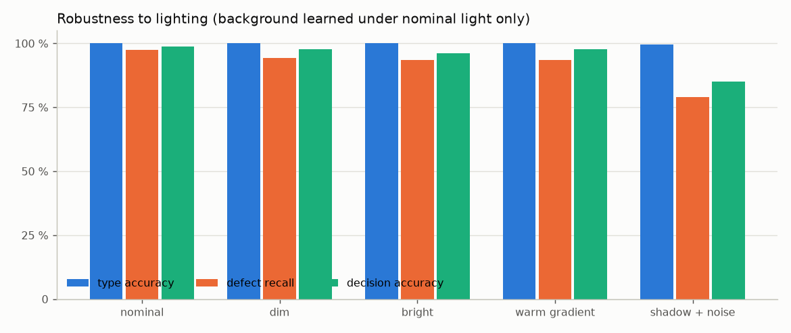

# Evaluation

How the system was tested, what each number means, and how the results compare with the targets
set in the [design](DESIGN.md) before building.

> All results are on **synthetic** data. They show that the method works as designed and how it
> degrades under bad lighting. They are **not** a measurement on real gloves, which are smoother
> in some ways (no crumpled folds) and harder in others (reflections, real textures).

## Data

| Set | Seed | Size | Used for |
|---|---|---|---|
| `data/train` | 1 | 900 still images | MLP training, golden finger statistics (defect-free gloves only) |
| `data/test` | 2 | 900 still images | all metrics below; never used for training or threshold fitting |
| `data/videos/demo.mp4` | 7 | 12 gloves, 817 frames (41 s) | tracking, voting, counting, GIF |
| `data/sample` | 11 | 15 images | debugging during development |

The test set has 300 gloves of each type, alternating lighting conditions (180 each), random hand,
rotation (±50° around fingers-up or fingers-down) and colour. 35 % of the gloves are defect-free;
the rest have one (70 %) or two (30 %) different defect types. All datasets can be regenerated
bit-for-bit with the commands in the README.

## Method

`results/evaluate.py`:
1. Calibrates from the dataset's `calib.png` and learns the plate from `background.png`, which is
   taken under nominal light only.
2. Runs `Inspector.inspect_still` on every image.

**Matching defects:** ground-truth positions are mapped into the rectified image. Detections are
matched to ground truth of the same type, greedily by distance, within a radius:

| Defect | Match radius |
|---|---|
| hole, pinhole, dirt | 12 mm |
| stain, tear | 15 mm |
| fused fingers, cuff defect | 40 mm |
| missing finger | 45 mm |

- **Out of tolerance** is a whole-glove label, so it is scored present / absent.
- **Precision / recall** are counted per defect instance (a glove with three dirt spots counts three).
- **Size error** = measured − true, computed only for matched pairs:
  - holes, pinholes, stains, dirt: diameter
  - tears: depth
  - cuff defects: maximum deviation
  - missing fingers: missing length
- **Decision accuracy** compares the fuzzy decision with a crisp rule table applied to the
  *ground-truth* defects: any barrier defect → REJECT; only stain, dirt or size → REWORK;
  none → PASS.
- **Confusion matrix of defects:** for each missed ground-truth defect, the nearest unmatched
  detection of *another* type within the radius is recorded (e.g. a stain detected as a hole).
  Remaining unmatched detections are false alarms.

`results/evaluate_video.py` runs the full video pipeline (tracking, voting, fuzzy decision) and
compares the finished gloves, in order of appearance, with the video's ground truth.

Every wrong result of the still-image test is listed in [`results/failures.csv`](../results/failures.csv).

## Results against the design targets

| Metric | Target (design §7) | Result | Met? |
|---|---|---|---|
| Glove type accuracy | ≥ 95 % | 99.9 % | yes |
| Length / width MAE (synthetic) | ≤ 2 mm | 0.80 / 0.71 mm | yes |
| Hole diameter MAE (holes ≥ 2 mm) | ≤ 0.5 mm | 0.29 mm (holes), 0.28 mm (pinholes) | yes |
| Precision & recall ≥ 90 %: holes | ≥ 90 % | 93 % / 95 % | yes |
| tears | ≥ 90 % | 92 % / 88 % | recall no |
| missing / fused fingers | ≥ 90 % | 69 % / 82 % and 76 % / 100 % | **no** |
| stains | ≥ 90 % | 92 % / 97 % | yes |
| Precision & recall ≥ 80 %: pinholes | ≥ 80 % | 79 % / 89 % | precision just below |
| dirt | ≥ 80 % | 97 % / 83 % | yes |
| cuff defects | ≥ 80 % | 78 % / 97 % | precision just below |
| Orientation (hand) | ≥ 98 % | 97.7 % | **no** (direction: 100 %) |
| Lighting: accuracy drop | ≤ 5 points | type 0.6, decision 1–14 points | decision under shadow + noise: **no** |
| Speed | ≥ 15 FPS | ~5 FPS (video, 1600 × 900) | **no** |
| Real-glove length / width MAE | ≤ 3 mm | not measured yet | – |

## Per lighting condition

| Lighting | Type | Hand | Defect precision | Defect recall | Decision | Length MAE |
|---|---|---|---|---|---|---|
| nominal | 100 % | 97.8 % | 91.3 % | 97.4 % | 98.9 % | 0.51 mm |
| dim (×0.6) | 100 % | 98.9 % | 89.3 % | 94.4 % | 97.8 % | 0.57 mm |
| bright (×1.3) | 100 % | 98.3 % | 94.0 % | 93.4 % | 96.1 % | 0.58 mm |
| warm + gradient | 100 % | 97.2 % | 88.5 % | 93.6 % | 97.8 % | 0.62 mm |
| shadow + noise + blur + JPEG 75 | 99.4 % | 96.1 % | 65.7 % | 79.1 % | 85.0 % | 1.70 mm |



## Error analysis

From `results/failures.csv` and the confusion matrix:

- **False finger alarms (33 missing-finger, 27 fused-finger)** are the largest group. Rotated
  gloves with strongly splayed or very short little fingers produce fingertip peaks that land in
  the wrong slot, or valleys higher than the learned normal. Golden values are medians, without a
  per-type spread, so the thresholds cannot adapt to natural variation.
- **Pinhole false alarms (16)** come mainly from the shadow + noise condition, where noise and
  blur create small low-contrast spots.
- **Dirt misses (27 of 167)** are the smallest specks (≈ 1.5 mm = 3 px) after blur.
- **Tear depth −4 mm bias:** the narrow notch tip is lost at 0.5 mm/px. Detection itself is reliable.
- **Cuff false alarms (21)** happen when a tear or missing material near the cuff corner bends
  the fitted end line.

## How the numbers changed during development

| Stage | Pinhole recall | Hole size MAE | Decision accuracy |
|---|---|---|---|
| first full run | 13 % | 1.90 mm | 91.1 % |
| relative-only test for small holes, sub-pixel area | 89 % | 0.09 mm (150-glove check) | 97.3 % (150-glove check) |
| + dark-particle test (dirt vs. pinhole) | 89 % | 0.29 mm (full set) | **95.1 % (full set)** |

The thresholds were tuned while looking at the sample set and the first 150 test images, so the
test set is not completely untouched. A fresh dataset with a new seed would give an unbiased
number; the per-lighting and per-defect patterns are expected to hold.

## Reproduce

```bash
glovesim stills --out data/test --n 900 --seed 2
python results/evaluate.py --data data/test --out results            # ~8 min
python results/evaluate_video.py --video data/videos/demo.mp4 --out results
```
