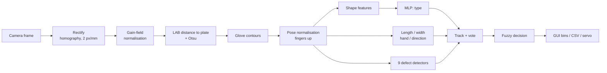

# Technical reference

How each part of the pipeline works, with the equations and the configuration keys that control
it. Code references point to `src/gloveinspect/`.

- [1. Overview](#1-overview)
- [2. Calibration](#2-calibration--calibrationpy)
- [3. Segmentation](#3-segmentation--segmentationpy)
- [4. Pose normalisation](#4-pose-normalisation--analysispy)
- [5. Measurements and orientation](#5-measurements-and-orientation)
- [6. Glove type (MLP)](#6-glove-type-mlp--classifypy)
- [7. Defect detectors](#7-defect-detectors)
- [8. Fuzzy decision](#8-fuzzy-decision--decisionpy)
- [9. Tracking and voting](#9-tracking-and-voting--inspectorpy)
- [10. Synthetic data generator](#10-synthetic-data-generator--srcglovesim)
- [11. Configuration reference](#11-configuration-reference)
- [12. Module map](#12-module-map)

## 1. Overview



Design rules taken from the original problem statement:
- identify glove types by size and shape, not by colour
- measure in millimetres
- stay robust to environment changes
- use no Haar cascades, no TensorFlow and no template/pattern matching
- include fuzzy logic or a neural network (this project uses both)

## 2. Calibration (`calibration.py`)

A photo of a printed checkerboard (9 × 6 inner corners, 20 mm squares) is taken once.
`cv2.findChessboardCornersSB` finds the corners. The homography $H_b$ from image pixels to board
millimetres is fitted with `cv2.findHomography`. The corner order is normalised so the first corner
is the top-left one; this keeps the rectified image upright.

The output image is defined by

```math
H = S \cdot H_b, \qquad S = \begin{pmatrix} s & 0 & -s\,x_{min} \\ 0 & s & -s\,y_{min} \\ 0 & 0 & 1 \end{pmatrix}
```

with $s$ = `calibration.output_px_per_mm` (2 px/mm) and $(x_{min}, y_{min})$ the smallest board
coordinate of the four image corners, so the whole camera view fits. Every frame is warped with $H$;
after that **1 px = 0.5 mm everywhere**, and perspective from a slightly tilted camera is removed.
The reprojection RMS of the corners is reported (0.06–0.10 mm on the synthetic camera).
A *valid mask* marks rectified pixels that the camera actually sees. A glove is only analysed
when its contour does not touch the border of that mask.

The checkerboard is used only to calibrate the camera, not to detect gloves.

## 3. Segmentation (`segmentation.py`)

**Plate model.** The median of the first `segmentation.learn_frames` (15) rectified frames of
the empty plate, $B(x,y)$, is stored, together with its CIE-LAB version.

**Illumination normalisation.** For each frame $F$ and each colour channel $c$, the ratio
$r_c = F_c / B_c$ is modelled as a planar gain field

```math
g_c(x, y) = a_c + b_c\,\tilde x + c_c\,\tilde y, \qquad \tilde x, \tilde y \in [-0.5, 0.5]
```

and fitted by least squares on a grid (every 8 px). The fit is made robust as follows:
- the initial inliers are pixels within ±25 % of the median ratio
- three refits then drop points with a residual above $3\cdot1.4826\cdot\text{MAD} + 0.02$

Because gloves cover well under half of the plate, glove pixels end up as outliers. The compensated
frame $F'_c = F_c / g_c$ has the plate's lighting. This cancels global brightness, colour temperature
(per-channel gain) and linear light gradients.

**Distance to the plate.** With $\Delta L, \Delta a, \Delta b$ the LAB differences between
$F'$ and $B$:

```math
D = \sqrt{\Delta a^2 + \Delta b^2} + w\,|\Delta L|
```

with $w$ = `l_weight` = 0.5.

Chroma counts fully and lightness only half, so a soft shadow (mostly $\Delta L$) stays below the
threshold while a coloured glove does not. The full CIE76 $\Delta E$ is also kept for the hole
detector. $D$ is smoothed ($\sigma$ = 1 px), and the threshold is
the larger of Otsu($D$) and `min_contrast`, computed on every frame. After a 3 × 3 opening and
closing, external contours with area ≥ `min_glove_area_mm2` are gloves.

Nothing in this step depends on the glove's colour. The only requirement is that glove and plate
differ, in practice by chroma.

**Slow adaptation.** Every 10th frame, plate pixels far from any glove are blended into $B$ with
rate `bg_update_rate` (2 %), for live cameras that drift.

## 4. Pose normalisation (`analysis.py`)

Each glove is cropped and rotated into the **N-frame** (fingers up, cuff down, principal axis
vertical):

1. **PCA** of the mask pixels gives the main axis; rotate it to vertical.
2. **Fingers end:** count rows that cross the mask in ≥ 3 separate runs (rows through fingers).
   If there are more such rows in the lower half, rotate by 180°.
3. **Refine:** the PCA axis is pulled sideways by the thumb, so a straight line is fitted
   (robust, 2 px trimming) to the mid-points of the bottom 30 % of rows (cuff and lower palm).
   The glove is rotated again by $\arctan(-\text{slope})$.

All maps (mask, $\Delta E$, LAB, plate lightness) are warped once with the final affine transform.
Its inverse maps every result back to the rectified image.

## 5. Measurements and orientation

| Quantity | Definition in the N-frame |
|---|---|
| Length | rows from the top of the longest finger to the cuff end, / (px/mm) |
| Palm top | lowest point of the valleys between the four fingers (from the top profile, §7.4) |
| Width | length of the mask run containing the centre line, 15 mm below the palm top |
| Centre line $c$ | median mid-point of the bottom 30 % of rows |
| Thumb side | side with the larger lateral extent from $c$ |
| Hand | thumb on the left (fingers up, back of hand to the camera) → **right** hand, otherwise left; "?" if the thumb protrusion is < 35 % of the learned nominal |
| Direction | fingertip end above the cuff end in the rectified image → *fingers up* |

**Known ambiguity:** a silhouette cannot tell a left glove palm-up from a right glove palm-down.
The stated convention (back of the hand faces the camera) resolves this; it has to hold on the
real line.

## 6. Glove type (MLP) (`classify.py`)

13 shape features, all in mm or dimensionless:
- length, area, maximum width
- aspect ratio, solidity (area / convex hull area), extent (area / (length × max width))
- widths at 50 / 65 / 80 / 95 % of the length
- log-scaled Hu moments 1–3

A scikit-learn pipeline `StandardScaler → MLPClassifier(32, 16)` (L2 α = 1e-3, Adam) is trained on
the training set (`python -m gloveinspect.train`). The three synthetic types differ in size and
shape:

| Type | Length | Palm width | Shape cue |
|---|---|---|---|
| exam | 237 mm | 95 mm | short straight cuff, slim fingers |
| longcuff | 331 mm | 100 mm | 150 mm flared cuff |
| garden | 239 mm | 118 mm | wide palm, thick short fingers |

**Golden values.** For finger checks the system needs to know what a *good* glove of that type looks
like. `learn_golden` stores the medians over defect-free training gloves (104–118 per type) of:
- finger length / palm width for index, middle, ring and little finger
- lateral fingertip positions / palm width
- thumb protrusion = (thumb-side extent − other-side extent) / palm width
- thumb tip position
- typical valley height
- palm-top position

These are measurements, not template images.

## 7. Defect detectors

All sizes are converted to mm with the calibrated scale.

### 7.1 Holes and pinholes

A hole shows the plate, so its $\Delta E$ to the plate drops far below that of the surrounding glove.

1. Local reference by **normalised convolution** over glove pixels $W$:
   $\overline{\Delta E}(x) = \dfrac{G_\sigma * (\Delta E \cdot W)}{G_\sigma * W}$,
   with $\sigma$ = `local_ref_window` / 4 = 10 mm. It is computed twice; the second pass leaves out
   the candidates found in the first.
2. Candidate pixels: $\Delta E < 0.5\,\overline{\Delta E}$ (`hole_bg_fraction`).
3. Each connected component is checked:
   - It is rejected if it lies within 3 mm of the outline (that is a notch, handled in §7.3).
   - **Size:** a sub-pixel "plateness" $p = \text{clip}\big((\overline{\Delta E}-\Delta E)/(\overline{\Delta E}-\Delta E_{plate}),0,1\big)$
     is summed over the component dilated by 2 px. Area $A = \sum p\,/\,s^2$ and diameter
     $d = \sqrt{4A/\pi}$; this removes the bias of blurred edges.
   - Components with $d \ge 3.8$ mm (`pinhole_max_diameter`) must also reach
     $\Delta E < \max(8,\ 1.5 \cdot P_{90}(\Delta E_{plate\ ring}))$, so a stain that only looks
     *similar* to the plate is not counted. Pinholes are too small to reach the plate colour after
     camera blur, so only the relative test applies to them.
   - **Dark-particle test:** a component whose darkest pixel is more than 12 L units darker than
     both the plate and the surrounding glove is dirt, not a hole.
4. $d < 3.8$ mm → *pinhole*, otherwise *hole*. Stored: diameter, area.

### 7.2 Stains and dirt

Inside the glove minus a 2 mm edge band and minus the holes, local LAB references
$\bar L, \bar a, \bar b$ are computed by the same two-pass normalised convolution. A pixel is a
candidate if

```math
\sqrt{(a-\bar a)^2 + (b-\bar b)^2} \ge 12 \quad\text{or}\quad L-\bar L \le -22 \quad\text{or}\quad L-\bar L \le -0.6\cdot 20
```

Components of at least `min_spot_area_mm2` are classified:
- **dirt:** diameter ≤ 5 mm and darkest pixel ≥ 20 L below its surroundings
- **stain:** diameter ≥ 5 mm (diameter, area and mean colour difference are stored)
- anything else is ignored as noise

The local reference follows smooth shadows and the glove's own shading, which global thresholds
(as in 2020) cannot.

### 7.3 Edge tears

In the N-frame, the outermost mask column per row, $x_L(y)$ and $x_R(y)$, is taken for rows from
8 mm below the palm top to 4 mm above the cuff end. For the left edge:

```math
\text{dev}(y) = x_L(y) - \max\big(\operatorname{med} x_L[y-w : y-g],\ \operatorname{med} x_L[y+g : y+w]\big)
```

with $w$ = 25 mm and $g$ = 6 mm (mirrored for the right edge). A notch is inward relative to *both*
neighbourhoods. A straight, slanted or convex outline, or a one-sided step such as the thumb base,
gives dev ≤ 0. Runs with dev ≥ 3.5 mm and shorter than 25 mm are tears; depth = max dev.

*Limitation:* the tip of a narrow notch is thinner than a pixel, so the depth is under-estimated
(about 4 mm on the test set).

### 7.4 Missing / short and fused fingers

The **top profile** $t(x)$ is the first mask row in every column, median-filtered over 5 px.
Fingertips are peaks of $-t(x)$ with prominence ≥ 12 mm (`scipy.signal.find_peaks`). A peak more
than 0.9 × the other side's extent out on the thumb side is the thumb; up to 4 remaining peaks are
fingers.

- **Slot assignment:** the k detected fingertips are matched to the 4 expected lateral positions
  (golden `tip_s_ratio` × width) by testing all ordered combinations and keeping the one with the
  smallest total distance.
- **Short finger:** measured length (palm top − tip) < 0.75 × golden length ratio × width.
  The missing length is stored.
- **Missing finger:** an expected slot with no fingertip; missing length = expected length.
- **Thumb:** thumb protrusion < 0.75 × golden value → short or missing thumb. The size given for
  the thumb is approximate.
- **Fused fingers:** the valley between two *adjacent* fingers sits ≥ 12 mm higher than the
  learned normal valley height (`fused_min_elevation`).

### 7.5 Cuff defects

For every column of the cuff end (bottom 25 mm, inner 90 % of the width), the last mask row gives
the end profile. A robust line is fitted:
- the initial fit uses the 40 % lowest points (intact edge)
- it is then refined on points within 1.5 mm

Material missing from the end (a bite or a jagged edge) shows up as positive deviation. Runs with a
maximum ≥ 3.5 mm are cuff defects (maximum deviation and span are stored).

### 7.6 Out of tolerance

$|L - L_{spec}| > 10$ mm or $|W - W_{spec}| > 6$ mm for the detected type. In video, the medians
over all analyses are used.

## 8. Fuzzy decision (`decision.py`)

Crisp inputs:

| Input | Range | Computed from |
|---|---|---|
| integrity | 0–10 | max over barrier defects: hole 6 + d/3, pinhole 5 + d, tear 5 + depth/3, missing finger 8, fused 6, cuff 4 + dev/2 |
| cosmetic | 0–10 | sum: stain 3 + d/5, dirt 2.5 each |
| dimension | 0–3 | max(\|ΔL\|/tol_L, \|ΔW\|/tol_W) |

Membership functions (trapezoid / triangle):
- integrity: none [0,0,0.5,2], minor [1,3,5], major [4,6,10,10]
- cosmetic: none [0,0,0.5,1.5], light [0.5,3,6], heavy [5,7,10,10]
- dimension: ok [0,0,0.8,1.0], off [0.9,1.1,3,3]
- quality: reject [0,0,20,40], rework [30,50,70], pass [60,80,100,100]

Mamdani rules:
1. integrity major → reject
2. integrity minor → rework
3. integrity none ∧ cosmetic none ∧ dimension ok → pass
4. integrity none ∧ cosmetic light → rework
5. integrity none ∧ cosmetic heavy → rework
6. integrity none ∧ dimension off → rework

Centroid defuzzification gives a quality score $q$ ∈ [0, 100]: PASS if $q$ ≥ 65, REWORK if
$q$ ≥ 35, otherwise REJECT.

The rules encode a typical medical-glove policy: any barrier defect rejects; cosmetic or size
problems go to rework / second grade. On the synthetic data, whose ground truth follows the same
crisp table, the fuzzy layer mainly reproduces it. Its value is a graded score for borderline cases
and rules that can be edited without changing code.

## 9. Tracking and voting (`inspector.py`)

- Blobs are linked to tracks by nearest centroid (≤ 150 mm jump). A track is dropped after 2
  frames without a match.
- A glove is analysed on every 3rd frame in which it is complete (`analyse_every`), at most 8 times
  (`max_observations`). It is finalised after 8 analyses, or when it becomes incomplete / leaves
  the view with ≥ 3 analyses.
- **Voting:**
  - type by summed class probabilities
  - hand (ignoring "?") and direction by majority
  - length and width by median
  - defects are clustered per type in glove coordinates (12 mm radius; 30 mm for finger, cuff and
    size defects) and kept if present in ≥ 40 % of the analyses; the size is the median member

Analysing a subset of frames keeps the speed at ~5 FPS (1600 × 900, laptop CPU) while every glove
still gets 8 independent looks.

## 10. Synthetic data generator (`src/glovesim`)

- **Glove model** (`model.py`): local frame in mm. Body polygon (cuff end → wrist → palm), five
  capsule fingers with splay angles, and an angled thumb. Each glove gets ±1.2 % random production
  variation. The model is drawn as a right hand seen from the back; left hands are mirrored.
  Rasterised at 4 px/mm with anti-aliasing.
- **Defects** (exact ground truth in mm):

  | Defect | How it is generated |
  |---|---|
  | hole | irregular polygon, 4.5–15 mm |
  | pinhole | circle, 1.8–3.2 mm |
  | tear | triangular notch in the palm/cuff side, mouth 3–8 mm, depth 6–15 mm, ±20° |
  | missing finger | finger shortened by 40–100 % |
  | fused fingers | web over 55–80 % of the shorter finger |
  | stain | soft ellipse 8–24 mm; colour must differ from glove *and* plate |
  | dirt | 1–3 dark spots, 1.5–4 mm |
  | cuff defect | bite (r 6–14 mm) or jagged edge |
  | out of tolerance | glove scaled by 0.90–0.93 or 1.07–1.10 |

  Ground-truth length and width are measured on the rendered mask. The out-of-tolerance label is
  recomputed from the real rendered size.
- **Appearance:** random glove colour (7 families, contrast to the plate ≥ 25), low-frequency
  shading, creases, a knit texture for garden gloves, edge darkening, a slight drop shadow.
- **Scene** (`scene.py`): 850 × 500 mm plate at 2 px/mm with fine texture; a camera homography
  with ±20 px random corner tilt; 1600 × 900 output; vignetting.
- **Lighting conditions** (the plate reference is always taken under *nominal*):

  | Condition | Changes |
  |---|---|
  | nominal | – |
  | dim | gain 0.6 |
  | bright | gain 1.3 |
  | warm_gradient | channel gains B 0.82 / G 0.97 / R 1.12 + 35 % horizontal and 20 % vertical gradient |
  | shadow_noise | soft elliptical shadow −35 %, noise σ 6, blur σ 1, JPEG 75 |

  Every image also gets ±5 % random gain, sensor noise and JPEG compression.
- **Videos:** gloves move across the plate at 180 mm/s (20 fps), 520 mm apart, while the light
  varies sinusoidally (±22 % gain, ±25 % gradient).

## 11. Configuration reference

`config/config.yaml`. Every key has a comment in the file. Most important:

| Key | Default | Effect |
|---|---|---|
| `calibration.board` | 9 × 6, 20 mm | printed checkerboard |
| `calibration.output_px_per_mm` | 2.0 | resolution of all measurements (smaller = faster, misses small defects) |
| `segmentation.learn_frames` | 15 | empty-plate frames at start |
| `segmentation.min_contrast` | 10 | lower bound of the Otsu threshold on D |
| `segmentation.l_weight` | 0.5 | weight of lightness vs. chroma (shadow tolerance) |
| `glove_types.<t>.length/width` | spec | product specification per type |
| `tolerance.length/width` | 10 / 6 mm | dimensional tolerance |
| `defects.hole_bg_fraction` | 0.5 | relative hole test |
| `defects.pinhole_max_diameter` | 3.8 mm | pinhole vs. hole |
| `defects.stain_chroma`, `stain_dl` | 12, 22 | stain sensitivity |
| `defects.dirt_dl`, `dirt_max_diameter` | 20, 5 mm | dirt sensitivity |
| `defects.tear_min_depth` | 3.5 mm | smallest reported tear |
| `defects.cuff_min_dev` | 3.5 mm | smallest reported cuff defect |
| `defects.short_finger_ratio`, `thumb_ratio` | 0.75 | finger length / thumb protrusion vs. golden |
| `defects.fused_min_elevation` | 12 mm | fused-finger sensitivity |
| `decision.pass_min`, `rework_min` | 65, 35 | quality score limits |
| `tracking.analyse_every`, `max_observations`, `vote_fraction` | 3, 8, 0.4 | speed vs. evidence |
| `sorter.angles` | 30/90/150° | must match the Arduino sketch |

## 12. Module map

| File | Responsibility |
|---|---|
| `config.py` | YAML loading, project-relative paths |
| `calibration.py` | `Rectifier`: checkerboard homography, warping, valid mask, save/load |
| `segmentation.py` | `BackgroundModel`: plate learning, gain field, LAB distance, contours |
| `analysis.py` | `analyse_glove`: pose normalisation, measurements, orientation, all defect detectors |
| `classify.py` | features, `TypeClassifier` (MLP), golden statistics |
| `decision.py` | `FuzzyDecider`, severity mapping, crisp rule table (evaluation ground truth) |
| `inspector.py` | `Inspector`: per-frame processing, tracking, voting, `inspect_still` |
| `overlay.py` | drawing of outlines, labels and decisions |
| `logger.py` | CSV logging |
| `sorter.py` | simulated bins and serial servo sorter |
| `train.py`, `cli.py` | training and command-line entry points |
