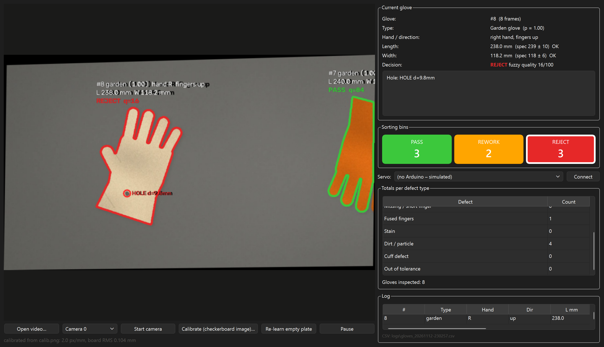

# User guide

How to install the software, set up a camera station, calibrate it, run the GUI, connect the
Arduino sorter and read the logs.

- [1. Install](#1-install)
- [2. Try it on synthetic data](#2-try-it-on-synthetic-data)
- [3. Set up a real inspection station](#3-set-up-a-real-inspection-station)
- [4. Calibrate (millimetres)](#4-calibrate-millimetres)
- [5. Run the GUI](#5-run-the-gui)
- [6. Arduino servo sorter](#6-arduino-servo-sorter)
- [7. Logs (CSV)](#7-logs-csv)
- [8. Command line](#8-command-line)
- [9. Adapting to your own gloves](#9-adapting-to-your-own-gloves)
- [10. Troubleshooting](#10-troubleshooting)

## 1. Install

Requirements: Python 3.10 or newer (tested with 3.12 on Windows 11), a webcam or video files.
An Arduino and a hobby servo are optional.

```bash
git clone https://github.com/turtleshelp/glove-defect-inspection.git
cd glove-defect-inspection
python -m venv .venv
.venv\Scripts\activate            # Linux/macOS: source .venv/bin/activate
pip install -e ".[gui,dev]"
pytest                            # 28 tests, ~20 s
```

> **Windows + OneDrive:** keep the virtual environment *outside* OneDrive (for example
> `python -m venv %USERPROFILE%\.venvs\glove-inspect`). Qt has very long file paths, and a synced
> 1 GB environment is slow.

The trained models (`models/type_mlp.joblib`, `models/golden.json`) are included, so you can
run the inspector without training.

## 2. Try it on synthetic data

```bash
glovesim video --out data/videos --name demo --n-gloves 12 --seed 7     # ~3 min
python app/gui.py --source data/videos/demo.mp4
```

The generator writes `calib.png` (checkerboard) next to the video, and the GUI calibrates from it
automatically. The first 15 frames show the empty plate, which the system learns as the background.

## 3. Set up a real inspection station

| Item | Recommendation |
|---|---|
| Camera | any USB webcam or phone camera, ≥ 1280×720, **pointing straight down** |
| Height | so that the largest glove fills about 1/2 to 2/3 of the image height (≈ 2 px/mm or better) |
| Plate / background | flat, **matte**, one colour that clearly differs from the gloves in colour (not only brightness); e.g. mid-grey card for blue/purple/green gloves |
| Light | diffuse room light or two lamps from the sides; avoid hard spotlights and glare |
| Gloves | laid **flat**, back of the hand towards the camera, fully inside the image |

The system tolerates moderate changes in brightness, colour temperature and light gradients
after the plate has been learned. Strong, sharp-edged shadows are the hardest case.

## 4. Calibrate (millimetres)

1. Print a checkerboard with **10 × 7 squares of 20 mm** (9 × 6 inner corners). Check the printed
   square size with a ruler; set `calibration.board.square_mm` if it differs.
2. Lay it flat on the plate under the camera and take **one photo** with the same camera.
3. In the GUI click **Calibrate (checkerboard image)…** and choose the photo, or start with
   `--calib photo.png`. The status bar shows the scale and the reprojection RMS (should be < 0.3 mm).

Calibration converts the camera image into a top-down image at 2 px/mm (set by
`calibration.output_px_per_mm`), which also removes perspective from a slightly tilted camera.
Without calibration the GUI still runs, but uses the fallback scale and says **NOT calibrated**
in the title bar.

Save a calibration for reuse:

```bash
glove-inspect calibrate photo.png --save config/calibration.json
```

## 5. Run the GUI

```bash
python app/gui.py                                   # pick a source in the window
python app/gui.py --source path/to/video.mp4        # video file
python app/gui.py --source 0 --calib board.png      # webcam 0
```



**Start-up:** keep the plate **empty** for the first ~1 s (15 frames) while the message
*Learning empty plate* is shown. If the light or camera position changes a lot later, empty the
plate and press **Re-learn empty plate**.

| Area | Content |
|---|---|
| Video | rectified top-down view. Cyan outline = glove being analysed; green / orange / red outline = finished glove (PASS / REWORK / REJECT) with type, hand, direction, length, width and fuzzy score; circles mark defects with their size |
| Current glove | type and classifier confidence, hand, finger direction, length and width against the spec and tolerance, decision with fuzzy quality score, list of defects |
| Sorting bins | count per bin; the bin that received the last glove is highlighted |
| Servo | COM port of the Arduino; *(no Arduino – simulated)* uses the GUI bins only |
| Totals per defect type | running count of every defect type |
| Log | one row per glove; the CSV file path is shown below |

Buttons: **Open video…**, **Start camera** (index from the drop-down), **Calibrate…**,
**Re-learn empty plate**, **Pause/Resume**.

**When is a glove decided?** A glove is analysed on every 3rd frame in which it is fully visible.
After 8 analyses (or when it leaves the image) the results are voted:
- glove type by summed classifier probability
- hand and direction by majority
- length and width by median
- a defect counts only if it was seen in at least 40 % of the analyses

The decision is then logged and sent to the sorter.

## 6. Arduino servo sorter

Wiring (Arduino Uno or Nano):

| Servo wire | Arduino |
|---|---|
| signal (orange/yellow) | D9 |
| V+ (red) | 5 V (use an external 5 V supply for anything bigger than an SG90) |
| GND (brown/black) | GND (shared with the external supply) |

1. Open `firmware/glove_sorter/glove_sorter.ino` in the Arduino IDE and upload it.
2. The serial monitor (9600 baud) shows `READY glove_sorter`. Typing `X` should move the servo to 150°.
3. Close the serial monitor, choose the COM port in the GUI and click **Connect**.

Protocol: the PC sends one character + newline per glove: `P` (PASS, 30°), `R` (REWORK, 90°),
`X` (REJECT, 150°); the Arduino answers `OK <c> <angle>`. Change the angles in the sketch
and in `sorter.angles` in the config together. The flap is held for 600 ms per glove.

## 7. Logs (CSV)

Every session writes two files to `logs/`:

`gloves_<session>.csv`, one row per glove:

| Column | Meaning |
|---|---|
| timestamp, session, source | when, which run, which video/camera |
| glove_id | track id |
| type, type_confidence | exam / longcuff / garden, mean classifier probability |
| hand, direction | R / L / ? and fingers_up / fingers_down |
| length_mm, width_mm | median measured length (cuff end to longest fingertip) and palm width |
| length_dev_mm, width_dev_mm | deviation from the spec of the detected type |
| n_frames | number of analyses voted |
| n_defects, defect_types | count and list of defects |
| integrity, cosmetic, dimension | fuzzy inputs (0–10, 0–10, 0–3) |
| quality_score, decision | fuzzy output 0–100 and PASS / REWORK / REJECT |

`defects_<session>.csv`, one row per defect: defect type, main size in mm (diameter, depth,
missing length …), position on the glove in mm (x from the centre line, y from the fingertip end)
and all detail measurements.

## 8. Command line

```bash
glove-inspect video data/videos/demo.mp4 --calib data/videos/calib.png --out annotated.mp4 [--port COM5]
glove-inspect video 0 --calib board.png                        # webcam, prints each glove
glove-inspect image photo.png --calib board.png --background empty_plate.png --out result.png
glove-inspect calibrate board.png --save config/calibration.json
python -m gloveinspect.train --data data/train
python results/evaluate.py --data data/test --out results
```

## 9. Adapting to your own gloves

1. **Product specs:** edit `glove_types` (nominal length and palm width per type) and `tolerance`
   in `config/config.yaml`.
2. **Glove types:** the MLP learns types from labelled examples. Record images of each type
   (and some defective ones), put them in the dataset format (a folder with `calib.png`,
   `background.png` and `labels.jsonl` with at least `file`, `type`, `defects: []` per image) and run `python -m gloveinspect.train --data <folder>`.
   The *golden* finger statistics are learned from the defect-free gloves in that set.
3. **Thresholds:** all detector thresholds are in the `defects:` section of the config, each
   with a comment. Re-run `results/evaluate.py` after changing them.

## 10. Troubleshooting

| Problem | Cause / fix |
|---|---|
| "checkerboard not found" | whole board must be visible, flat and sharp; check `board.cols/rows` are *inner corners* (9 × 6) |
| Glove outline includes shadows or misses parts | glove and plate too similar in colour; use a plate of a different colour; re-learn the plate |
| Many false holes on a light glove | strong shadow over the glove; diffuse the light |
| Hand shows "?" | thumb missing or folded; the hand cannot be decided from the outline |
| Lengths about 10 % off | not calibrated (title bar says NOT calibrated) or wrong `square_mm` |
| GUI very slow | high camera resolution; set the camera to 1280×720, or lower `output_px_per_mm` (smaller defects will be missed) |
| Arduino does not move | wrong COM port, serial monitor still open, servo needs its own 5 V supply |
